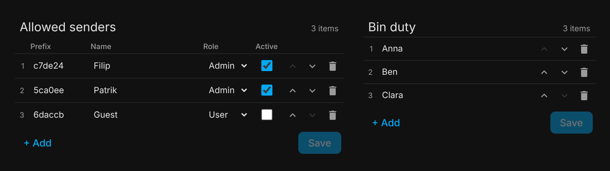

# Editable Lists pro Home Assistant

[English](README.md)

Upravitelné JSON seznamy pro automatizace a dashboardy: povolení odesílatelé, pořadí služeb,
fronty, cokoli, co bys jinak napsal natvrdo do šablony. Každý seznam je jedna položka integrace
s vlastním senzorem, volitelným schématem ověřovaným při každém zápisu, službami pro automatizace
a kartou pro ruční úpravy.



## Co umí

- **Jeden senzor na seznam.** Stav = počet položek, atribut `items` = celý seznam, v šablonách
  přes `state_attr()`.
- **Volitelné schéma.** Objekty s typovanými sloupci (`text`, `number`, `bool`, `enum`) nebo
  prosté hodnoty. Povinnost, unikátnost, regex, min/max a možnosti enumu se kontrolují na serveru,
  ať změna přijde z karty, nebo z automatizace.
- **Služby** pro nastavení, přidání, úpravu, odebrání, přesun a rotaci položek, volitelně
  s odpovědí.
- **Karta** `custom:editable-list-card`, kterou načítá integrace sama (nic se nepřidává do
  resources), s vizuálním editorem. Česky a anglicky.
- **Bezpečné souběžné úpravy.** Každá změna zvýší `revision`, karta nikdy nepřepíše změny, které
  mezitím udělal někdo jiný.
- **Úložiště** `.storage/editable_lists.<entry_id>`: přežije restart a je v zálohách. Do historie
  (recorder) jde jen počet položek, ne obsah.

## Instalace

### Marketplace

1. *Nastavení → Marketplace*, vyhledej **Editable Lists** a nainstaluj.
   Dokud není ve výchozím katalogu, použij *Přidat z odkazu* s
   `https://github.com/filipek92/ha-editable-lists`, kategorie *Integrace*.
2. Pokud si o to HA řekne, restartuj ho.

### Ručně

Zkopíruj `custom_components/editable_lists` do `<config>/custom_components/` a restartuj HA.

## Nový seznam

*Nastavení → Zařízení a služby → Přidat integraci → Editable Lists*. Každé přidání = jeden
seznam. Zadej název a volitelně schéma. Schéma jde později změnit přes *Konfigurovat*.

### Schéma

Buď `columns` (seznam objektů), nebo `value` (seznam prostých hodnot). Obojí prázdné = volný
seznam bez validace.

`columns`:

```yaml
- key: prefix
  label: Prefix
  required: true
  unique: true
  pattern: "^[0-9a-f]{6,}$"
  pattern_hint: Min. 6 hex znaků, malými
- key: jmeno
  label: Jméno
- key: role
  label: Role
  type: enum
  required: true
  options:
    - value: admin
      label: Admin
    - value: user
      label: Uživatel
- key: aktivni
  label: Aktivní
  type: bool
  default: true
```

`value`:

```yaml
type: text
unique: true
```

| Typ | Volby |
|---|---|
| `text` | `pattern` (regex), `pattern_hint`, `placeholder` |
| `number` | `min`, `max`, `step` |
| `bool` | `default` |
| `enum` | `options`: `[a, b]` nebo `[{value, label}]` |

Všechny typy kromě `bool` dále `required`, `unique` (bez ohledu na velikost písmen) a `default`.
`width` nastaví šířku sloupce v kartě.

Při zápisu se chybějící klíče doplní výchozí hodnotou, hodnoty se převedou na typ sloupce
(`"3"` → `3`, `"off"` → `false`) a klíče mimo schéma zůstanou.

## Služby

Všechny mají `entity_id` (senzor seznamu) a volitelně vrací odpověď `{items, revision}`.

| Služba | Parametry | |
|---|---|---|
| `editable_lists.set` | `items`, `revision`? | Nahradí celý seznam. S `revision` uloží jen tehdy, když se mezitím nezměnil. |
| `editable_lists.add` | `item`, `position`? | Přidá na konec nebo na pozici. |
| `editable_lists.update` | `index` / `match`, `data` / `item` | `data` doplní klíče objektu, `item` nahradí položku. |
| `editable_lists.remove` | `index` / `match` | Odebere všechny odpovídající položky. |
| `editable_lists.move` | `index` / `match`, `to` | Přesune jednu položku. |
| `editable_lists.rotate` | `steps` (výchozí 1) | První jde na konec, záporné kroky opačně. |
| `editable_lists.get` | | Vrátí obsah (jen jako odpověď). |

- `index` je od 0, záporný od konce (`-1` = poslední).
- `match` u objektů porovná uvedené klíče (`{prefix: c7de24}`), u prostých seznamů hodnotu.
  Texty bez ohledu na velikost písmen.

```yaml
- action: editable_lists.rotate
  data:
    entity_id: sensor.poradi

- action: editable_lists.update
  data:
    entity_id: sensor.meshcore_povolene
    match: {prefix: 5ca0ee}
    data: {aktivni: false}
```

## Šablony

```jinja
{# kdo je na řadě #}
{{ state_attr('sensor.poradi', 'items')[0] }}

{# aktivní prefixy #}
{{ state_attr('sensor.meshcore_povolene', 'items')
   | selectattr('aktivni') | map(attribute='prefix') | list }}

{# celý seznam jako JSON #}
{{ state_attr('sensor.meshcore_povolene', 'items') | to_json }}
```

## Karta

```yaml
type: custom:editable-list-card
entity: sensor.meshcore_povolene
title: Povolené kontakty   # volitelné
```

Sloupce bere ze schématu seznamu. Jedna karta je může přepsat klíčem `columns` nebo `value`
ve stejném formátu jako výše, mění se tím ale jen zobrazení, server dál ověřuje podle schématu
seznamu. Volný seznam karta zobrazí se sloupci odvozenými z dat.

Položky jde přidávat, mazat, upravovat a řadit. **Uložit** zapíše celý seznam přes
`editable_lists.set` s revizí, se kterou byl načtený. Když se seznam mezitím změnil jinde,
tvoje úpravy zůstanou a karta nabídne načtení nové verze.

## Vývoj

```sh
python -m pytest tests
```

Vydání: zvyš `version` v `manifest.json` a vydej GitHub release s tagem `v<verze>`.

## Licence

MIT
