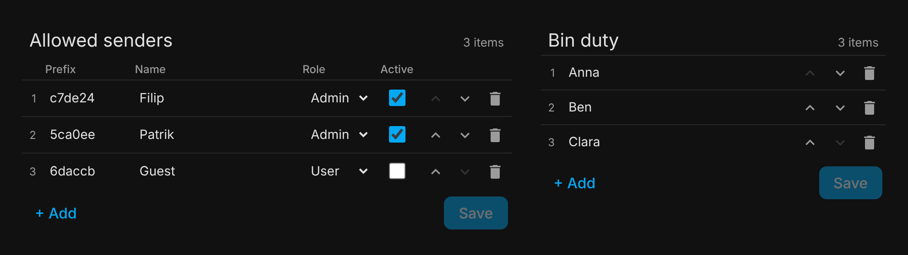

# Editable Lists for Home Assistant

[Česky](README.cs.md)

Editable JSON lists for automations and dashboards: allowed senders, rotation duty, queues,
anything you would otherwise hard-code in a template. Each list is a config entry with its own
sensor, an optional schema that is validated on every write, services to change it from
automations, and a dashboard card to edit it by hand.



## Features

- **One sensor per list.** State = number of items, attribute `items` = the whole list, readable
  in templates with `state_attr()`.
- **Optional schema.** Objects with typed columns (`text`, `number`, `bool`, `enum`) or plain
  values. Required, unique, regex, min/max and enum options are checked on the server, whether
  the change comes from the card or from an automation.
- **Services** to set, add, update, remove, move and rotate items, with optional responses.
- **Dashboard card** `custom:editable-list-card`, loaded by the integration (no resource to add),
  with a visual editor. English and Czech.
- **Safe concurrent edits.** Each change bumps a `revision`; the card never overwrites changes
  made elsewhere in the meantime.
- **Storage** in `.storage/editable_lists.<entry_id>`: survives restarts and is part of backups.
  The list content is not written to the recorder, only the item count.

## Installation

### Marketplace

1. *Settings → Marketplace*, search for **Editable Lists** and install it.
   Until it is in the default catalog, use *Add from link* with
   `https://github.com/filipek92/ha-editable-lists`, category *Integration*.
2. Restart Home Assistant if asked to.

### Manual

Copy `custom_components/editable_lists` into `<config>/custom_components/` and restart
Home Assistant.

## Creating a list

*Settings → Devices & services → Add integration → Editable Lists*. Each entry is one list.
Give it a name and, optionally, a schema. The schema can be changed later with *Configure*.

### Schema

Use either `columns` (list of objects) or `value` (list of plain values). Leave both empty for a
free-form list without validation.

`columns`:

```yaml
- key: prefix
  label: Prefix
  required: true
  unique: true
  pattern: "^[0-9a-f]{6,}$"
  pattern_hint: At least 6 lower-case hex characters
- key: name
  label: Name
- key: role
  label: Role
  type: enum
  required: true
  options:
    - value: admin
      label: Admin
    - value: user
      label: User
- key: active
  label: Active
  type: bool
  default: true
```

`value`:

```yaml
type: text
unique: true
```

| Type | Options |
|---|---|
| `text` | `pattern` (regex), `pattern_hint`, `placeholder` |
| `number` | `min`, `max`, `step` |
| `bool` | `default` |
| `enum` | `options`: `[a, b]` or `[{value, label}]` |

All types except `bool` also accept `required`, `unique` (case-insensitive) and `default`.
`width` sets the column width in the card.

When writing, missing keys are filled with the default, values are converted to the column type
(`"3"` → `3`, `"off"` → `false`) and keys outside the schema are kept.

## Services

All services take `entity_id` (the list sensor) and can return `{items, revision}` as a response.

| Service | Fields | |
|---|---|---|
| `editable_lists.set` | `items`, `revision`? | Replace the whole list. With `revision`, only save if the list has not changed since. |
| `editable_lists.add` | `item`, `position`? | Add at the end or at a position. |
| `editable_lists.update` | `index` / `match`, `data` / `item` | `data` merges keys into objects, `item` replaces the item. |
| `editable_lists.remove` | `index` / `match` | Remove all matching items. |
| `editable_lists.move` | `index` / `match`, `to` | Move one item. |
| `editable_lists.rotate` | `steps` (default 1) | First item becomes last; negative steps rotate the other way. |
| `editable_lists.get` | | Return the content (response only). |

- `index` starts at 0; negative counts from the end (`-1` = last).
- `match` compares the given keys for objects (`{prefix: c7de24}`) or the value for plain lists.
  Text is compared case-insensitively.

```yaml
- action: editable_lists.rotate
  data:
    entity_id: sensor.bin_duty

- action: editable_lists.update
  data:
    entity_id: sensor.allowed_senders
    match: {prefix: 5ca0ee}
    data: {active: false}

- action: editable_lists.add
  data:
    entity_id: sensor.allowed_senders
    item: {prefix: 6daccb, role: user}
```

## Templates

```jinja
{# whose turn it is #}
{{ state_attr('sensor.bin_duty', 'items')[0] }}

{# active prefixes #}
{{ state_attr('sensor.allowed_senders', 'items')
   | selectattr('active') | map(attribute='prefix') | list }}

{# the whole list as JSON #}
{{ state_attr('sensor.allowed_senders', 'items') | to_json }}
```

Example condition that only lets listed senders through:

```yaml
condition: template
value_template: >
  {{ (trigger.event.data.pubkey_prefix | default('') | lower)[:6] in
     state_attr('sensor.allowed_senders', 'items')
     | selectattr('active') | map(attribute='prefix') | list }}
```

## Card

```yaml
type: custom:editable-list-card
entity: sensor.allowed_senders
title: Allowed senders   # optional
```

The card takes its columns from the list schema. One card can override them with `columns` or
`value` in the same format as above; this only changes the display, the server still validates
against the list schema. A free-form list is shown with columns derived from the data.

You can add, delete, edit and reorder items. **Save** writes the whole list with
`editable_lists.set` and the revision it was loaded with. If the list changed elsewhere in the
meantime, your edits are kept and the card offers to load the new version.

## Development

The validation and list operations do not depend on Home Assistant:

```sh
python -m pytest tests
```

Releases: bump `version` in `manifest.json`, then publish a GitHub release tagged `v<version>`.

## License

MIT
